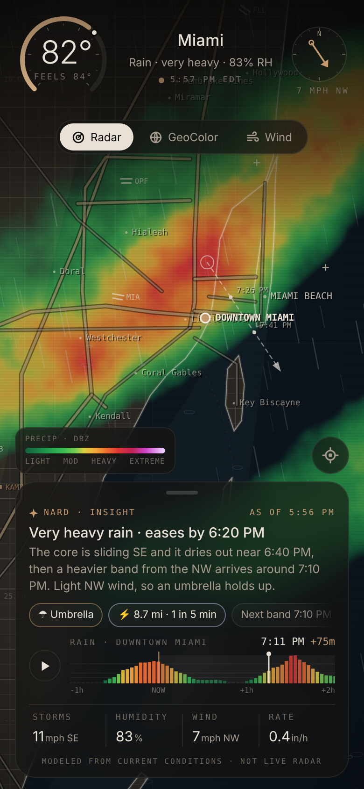
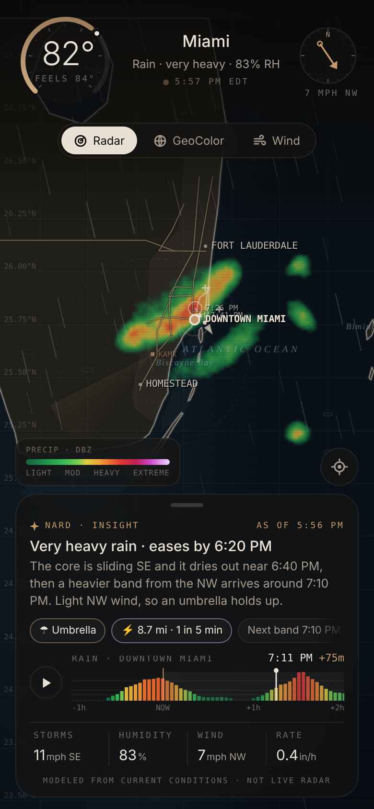

# miami-ai-weather

Mobile-first Miami AI Weather Helper: a live radar map of South Florida with particle rain, lightning and a short
practical insight. It's one file, `index.html`, with no libraries and no build step. It loads live map, radar and satellite tiles when it can reach them. Open it in any browser.

```bash
npm install
npm test
npm run build
```

`npm test` and `npm run build` check the helper without changing how you open it: still just `index.html`.

## What's on screen
- **Map**: hand-traced South Florida coastline, barrier islands, Biscayne Bay, the Keys, Florida Bay, Lake Okeechobee and the
  Bahamas (Bimini, Grand Bahama, Andros). Miami-Dade/Broward's 1-mile section-line street grid (arterials every 2 miles) and
  the expressways: I-95, the Turnpike, I-75, the 826, 836, 874, 924, 195, 395, 595 and the Sawgrass, plus US-1, US-27,
  Tamiami Trail, Krome and Card Sound. Also airports (MIA, FLL, OPF, TMB), water and park names, and the KAMX radar sweep
  and range rings. The coastline and roads sit above the weather so they stay readable under heavy rain. Drag to pan, pinch or scroll to zoom, tap anywhere to check that spot, ⌖ to come back to Miami.
- **Layers**: Radar (dBZ ramp green → yellow → orange → red → magenta), GeoColor (simulated satellite clouds lit by the
  low western sun, with shadows), Wind (streamlines, including gust-front outflow from the heavy cores).
- **HUD**: temperature dial (feels-like marker), wind compass, and a bottom panel with the insight, a rain strip for
  the selected spot from one hour ago to two hours ahead (it doubles as the loop scrubber), and stats. Live NEXRAD
  shortens the past side to −50 minutes.
- **Rain and lightning**: drop density follows the rain rate at the selected spot. Drop tilt follows the real wind vector
  (gravity plus horizontal drift ≈ wind speed ÷ ~9 m/s terminal fall speed). Lightning fires from cores ≥ 42 dBZ. A strike
  within ~10 mi flashes the screen and shows the distance and the thunder delay (distance ÷ 343 m/s).





## Live layers (on by default)
| Layer | Source | Notes |
|---|---|---|
| Satellite base map | Esri World Imagery + World Transportation roads | free with attribution, shown in the footer. Dimmed and desaturated under Radar/Wind, full colour under GeoColor |
| Radar | NEXRAD base reflectivity composite, Iowa Environmental Mesonet (`nexrad-n0q-900913`, now and −5…−50 min) | refreshed every 5 min. Tile colours are decoded back to dBZ (NWS ramp) and redrawn in our ramp |
| GeoColor | GOES-East via NASA GIBS WMTS | GeoColor, falling back to visible or clean IR. The layer is found at runtime from a test tile over Miami. Discovery walks 20–180 minutes of latency so a slow GIBS frame still wins. |
| Conditions | Open-Meteo `current` | temp, feels-like, RH, wind speed and direction, 15-min precipitation |

Everything reads from what's actually on screen:
- The rain strip, insight, rain overlay, lightning, gust outflow and storm track all come from the decoded radar.
- **Past** (−50 min → now) uses real radar frames. **Ahead** (→ +2 h) uses the latest frame moved along the storm-motion
  vector, which is a simple extrapolation nowcast, and it fades with lead time.
- If a source can't be reached, the page falls back to the drawn map and the model below. If the radar loads but its
  pixels can't be read (no CORS), it's shown view-only and the timing estimate is turned off. `?offline=1` skips the network.
- The footer always says which sources are live. Clock labels follow the wall clock, not the moment the tab first opened.

## The model (fallback)
When live radar is unavailable, everything comes from one deterministic field: storm cells built from Gaussian cores in
linear Z. A bowed leading line with trailing stratiform sits over you now, the next band builds upstream, and scattered
sea-breeze cells pop up and die. The cells are steered at 1.6× the surface wind, and each one grows and decays over its
own lifetime.
- Rain rate uses Marshall–Palmer, `Z = 200 R^1.6`. The model is calibrated so the observation point reads the observed
  rate right now (1.2 in/hr ≈ 47 dBZ).
- The radar, clouds, wind outflow, rain overlay, lightning, storm track and insight all read this same field. The footer
  says "Radar modeled".

## Data in
| Source | How |
|---|---|
| Built-in snapshot | `SNAPSHOT` at the top of the script (Miami, Oct 17 2026 late afternoon: 82°F / feels 84°, rain 1.2 in/hr, wind 7 mph from 326°, 83% RH) |
| Open-Meteo (no key) | automatic; `?offline=1` turns it off |
| JS | `NardWeather.set({...})`, `NardWeather.mode("radar"\|"geo"\|"wind")`, `NardWeather.focus(lat, lon)` |
| Parent frame | `postMessage({ type: "nard-weather", data }, "*")` (only accepted from `window.parent`) |

`set()` accepts this file's flat shape or Nard's `get_weather` tool output (`{ location, now: { temp_f, feels_like_f,
humidity_pct, wind_mph, precip_in, conditions } }`). Add `wind_dir_deg` (and optionally `precip_in_hr`).

## Nard integration (later, not done yet)
- The colour tokens are copied from NARD 2.0 (`public/nard-2.0/css/nard.css`): dark, muted amber and cool mono. Radar
  colours are data colours. The insight is labelled "Nard · insight".
- Planned: serve it as `public/weather/index.html` behind the passcode gate (no new public paths). Feed it from
  `/api/today` or the `get_weather` tool. Add `wind_direction_10m` to that tool's Open-Meteo `current=` list and return it
  as `now.wind_dir_deg`. That's an additive field, and the export format is unaffected.
- This repo does not add a PIN or account. The insight text is built on the device from the nowcast, so it costs zero
  neurons. An optional Workers AI rewrite could come later.
