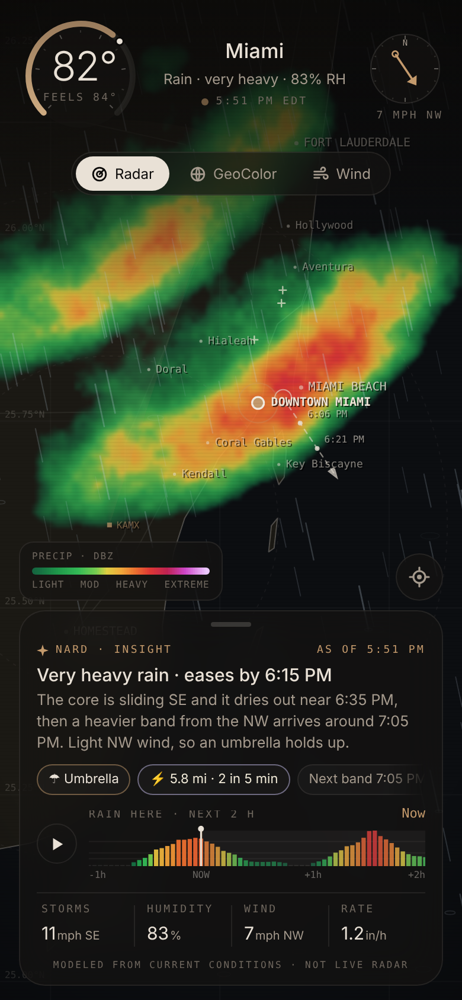
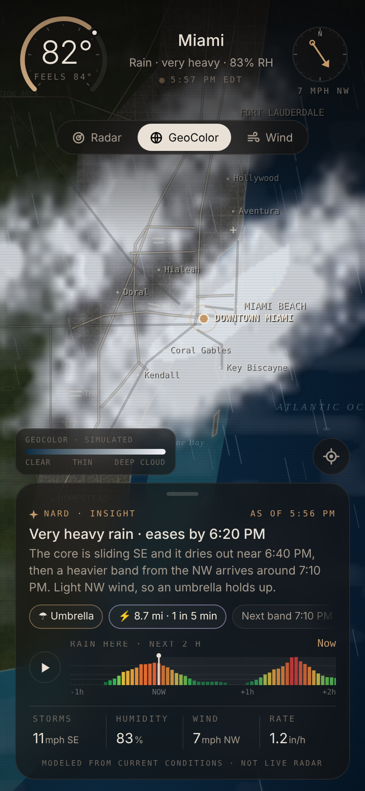
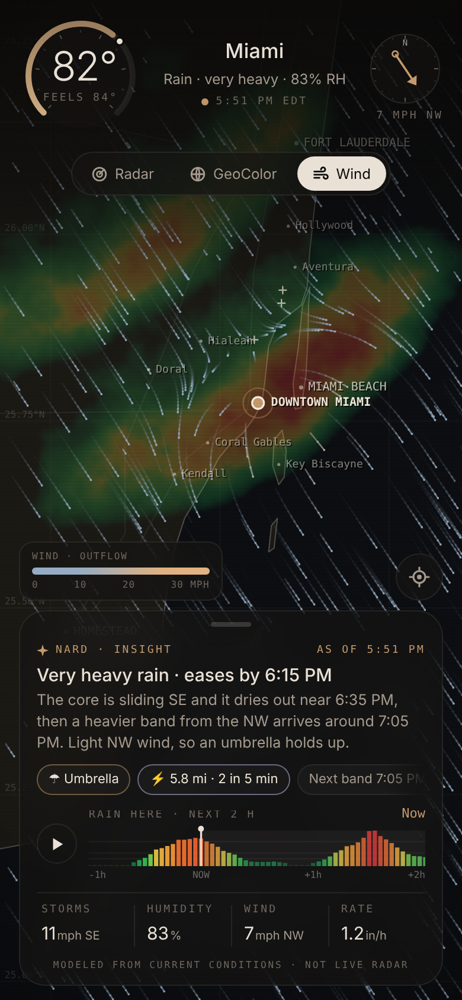

# Miami AI Weather

Mobile-first helper for South Florida weather: live conditions, a written briefing, neighborhood filters, animated radar, particle rain, tides, heat, and activity windows.

This is not a warning service. For watches and warnings use [NWS Miami](https://www.weather.gov/mfl/) and the [National Hurricane Center](https://www.nhc.noaa.gov/).

## Use it

```bash
npm install
npm test
npm run dev
```

Open `http://127.0.0.1:5173`. Pick a neighborhood, then switch views with the chips: Now, Hourly, Daily, Radar, Beach, Heat, Flood, Tropics, Play.

```bash
npm run build
npm run preview
```

There is no account, no PIN, and no deploy step in this repo.

## What it does

- **Now** — large temperature, hourly strip with icons, Rothfusz heat index, 15-minute nowcast line, and a deterministic AI briefing
- **Radar** — RainViewer mosaic on a dark map, play/pause, pin on the selected place
- **Particle rain** — canvas drops scale with live precipitation and wind, and stay off when `prefers-reduced-motion` is set
- **Filterable views** — neighborhood search plus nine desks (beach, heat, flood, tropics, play) in a sticky mobile toolbar
- **Flood desk** — Virginia Key tides plus king-tide windows and a compound-flood score
- **Play desk** — hour-by-hour scores for beach, run, commute, patio, boat, and kids
- **Offline last snapshot** — the last good feed for each neighborhood is saved locally and shown with a stale-time if live feeds miss
- **Alerts** — NWS headlines stay at the top of every desk, with an expiration countdown when the feed includes an end time

## Data

| Feed | Link |
| --- | --- |
| Forecast, air, marine | [Open-Meteo](https://open-meteo.com/en/docs) |
| Alerts | [NWS API](https://www.weather.gov/documentation/services-web-api) |
| Local office | [NWS Miami](https://www.weather.gov/mfl/) |
| Tides | [NOAA CO-OPS](https://tidesandcurrents.noaa.gov/) |
| Radar | [RainViewer API](https://www.rainviewer.com/api.html) |
| Tropics | [NHC](https://www.nhc.noaa.gov/) |
| Heat method | [NWS heat index equation](https://www.wpc.ncep.noaa.gov/html/heatindex_equation.shtml) |

## Docs

- [Research notes](docs/RESEARCH.md)
- [Handoff prompt](docs/HANDOFF.md)

## Tests

`npm test` covers heat index branches, flood scoring, briefing leads, activity windows, king-tide dates, formatters, Eastern-time feed parsing, snapshot revive, nowcast copy, and a mocked `loadSnapshot` run that never hits the network. CI runs tests and `npm run build`.

## Standalone radar helper

Claude's one-file helper still lives at [`public/radar-helper.html`](public/radar-helper.html). No libraries in the page. Open the file in any browser, or go to `/radar-helper.html` while `npm run dev` is running. `?offline=1` skips the network and uses the modeled field.

- **Map**: hand-traced South Florida coastline, barrier islands, Biscayne Bay, the Keys, Florida Bay, Lake Okeechobee and the Bahamas, plus the Miami-Dade/Broward street grid, expressways, airports, and KAMX rings. Drag to pan, pinch or scroll to zoom, tap a spot, ⌖ to return to Miami.
- **Layers**: Radar (dBZ green → magenta), GeoColor (GOES-East or modeled anvils), Wind (streamlines and gust-front outflow).
- **Live tiles** (on by default): Esri World Imagery + roads, IEM NEXRAD `nexrad-n0q-900913` (now and −5…−50 min), NASA GIBS GOES-East GeoColor (20–180 min latency walk), Open-Meteo current conditions.
- **Insight**: rain strip from one hour ago to two hours ahead (live radar uses −50 min), Marshall–Palmer nowcast, lightning within ~10 mi (distance ÷ 343 m/s).





`NardWeather.set / mode / focus` and parent-only `postMessage({ type: "nard-weather" })` still work. Nard passcode gating is later, not done — this repo has no PIN.
